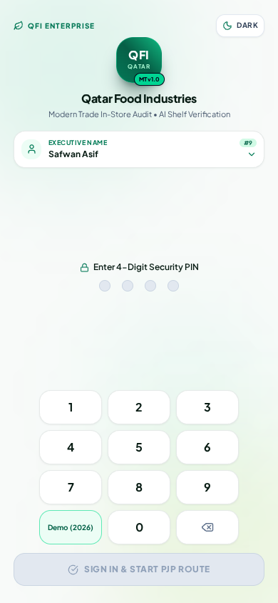
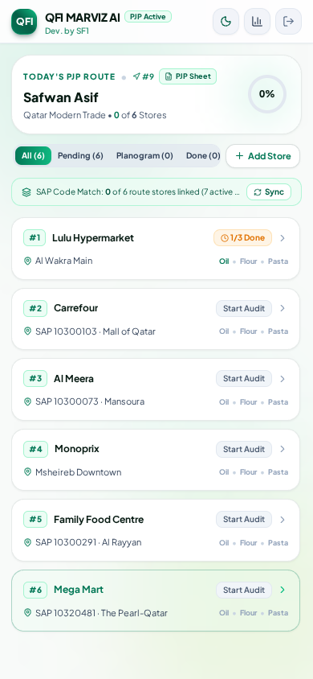
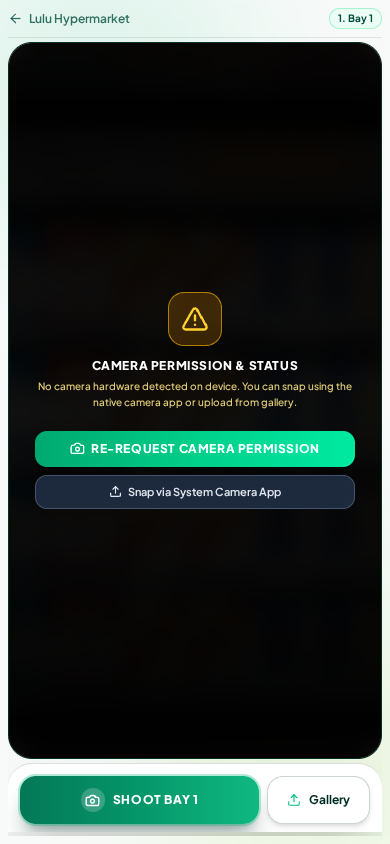
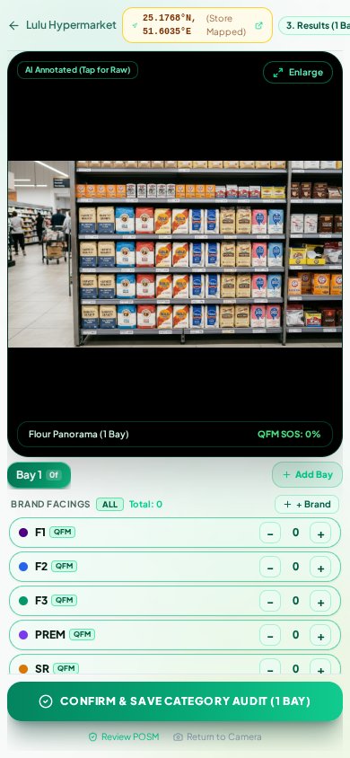
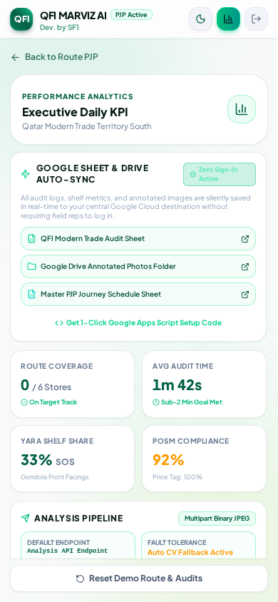

# CODEBASE_BRIEF.md — QFI MARVIZ AI (Modern Trade Visit Audit)

> **Purpose:** Factual technical inventory of the current codebase prior to full UI/UX redesign. Every statement below is verified against the files in this repository; external services and undocumented runtime behaviors are explicitly marked as **Unknowns**.

---

## 1. STACK & BUILD

### 1.1 Frameworks, Runtime & Package Management
| Layer | Package / Tool | Version / Spec | Source |
| :--- | :--- | :--- | :--- |
| **UI Framework** | `react`, `react-dom` | `^19.0.1` | `package.json` |
| **Language** | `typescript` (TypeScript compiler CLI in `lint` script: `tsc --noEmit`) | `^7.0.2` (devDep) | `package.json`, `tsconfig.json` |
| **Build Tool** | `vite`, `@vitejs/plugin-react` | `^8.3.0`, `^6.1.1` | `package.json`, `vite.config.ts` |
| **Styling** | Tailwind CSS v4 CSS-first (`tailwindcss`, `@tailwindcss/vite`, `autoprefixer`) | `^4.3.3`, `^4.3.3`, `^10.4.21` | `package.json`, `vite.config.ts`, `src/index.css` |
| **Backend / Dev Server** | `express` + `tsx` running `server.ts` on port `3000` (mounts Vite middleware in dev; serves `dist/` in prod) | `express ^5.3.0`, `tsx ^4.23.15` | `package.json`, `server.ts` |
| **Icons** | `lucide-react` | `^0.546.0` | `package.json` |
| **Auth / Cloud SDK (Installed)** | `firebase` (Firebase Auth + GoogleAuthProvider in `src/services/googleAuthService.ts`, currently unused in UI) | `^13.1.0` | `package.json`, `src/services/googleAuthService.ts` |
| **Analytics** | `@vercel/analytics` (`<Analytics />` in `src/main.tsx`) | `^2.0.1` | `package.json`, `src/main.tsx` |
| **Installed but Unused Dependencies** | `@google/genai` (`^2.4.0`), `motion` (`^12.23.24`), `vercel` (`^65.12.1`) | Zero imports anywhere in `src/` or `server.ts` | `package.json` |
| **Package Manager Lockfiles** | Both `package-lock.json` (npm) and `bun.lock` (Bun) exist; Vercel & npm scripts invoke `npm run build` | Dual lockfiles present | `package-lock.json`, `bun.lock`, `vercel.json` |
| **PWA Setup** | **None.** No `manifest.json`/`manifest.webmanifest`, no Service Worker (`sw.js`), no `vite-plugin-pwa`, no install prompt logic. | — | Workspace root, `index.html`, `vite.config.ts` |

### 1.2 NPM Scripts (`package.json`)
- `dev`: `tsx server.ts`
- `start`: `tsx server.ts`
- `build`: `vite build`
- `vercel-build`: `vite build`
- `preview`: `vite preview`
- `clean`: `rm -rf dist server.js`
- `lint`: `tsc --noEmit`

### 1.3 Folder Tree (2–3 Levels Deep)
```text
.
├── .aistudio/                  # AI Studio internal workspace artifacts
│   └── artifacts/brain/        # Stored planning artifacts from prior turns
├── data/                       # Server-side JSON flat-file persistence & caches (created/updated by server.ts)
│   ├── audit_logs.json         # Fallback local log of submitted category audits (written by POST /api/sheets/log)
│   ├── pjp_cache.json          # 5-minute cached parsed PJP CSV master data (written by GET /api/pjp/live)
│   └── planograms_cache.json   # 5-minute cached active planograms JSON (written by GET /api/planograms)
├── docs/                       # Documentation assets
│   └── screenshots/            # Current UI captures for Section 7 of this brief (01-login.png .. 05-dashboard.png)
├── google-sheets-v2/           # Standalone Google Apps Script V2 multi-tab backend reference files
│   ├── Code.gs                 # 757-line Apps Script web app script handling sync_visit, planograms, & Sheets tabs
│   ├── SETUP_GUIDE.md          # Setup instructions for deploying the Apps Script V2 backend
│   └── appsscript.json         # Apps Script project manifest (timezone, V8 runtime, web app access config)
├── public/                     # Static public assets served at root
│   └── assets/aistudio/        # Static image assets stored under AI Studio asset path
├── scripts/                    # Offline data-generation scripts
│   └── generate_pjp_data.cjs   # Node script generating static src/data/pjpMasterData.ts from PJP source data
├── src/                        # Frontend React + TypeScript application source
│   ├── assets/images/          # Bundled shelf reference JPGs (edible oil, flour, pasta)
│   ├── components/             # Screen and modal React components (10 .tsx files; no shared ui/ subfolder)
│   │   ├── AddOutletModal.tsx          # Modal to add ad-hoc or unmapped master store to today's PJP route (310 lines)
│   │   ├── CameraWorkflowScreen.tsx    # Monolithic 4-step category workflow: Capture, POSM, Results & Facings, Scorecard (4,219 lines)
│   │   ├── DashboardScreen.tsx         # Executive Daily KPI dashboard, Google Sheet/Drive links, GAS modal, batch export (624 lines)
│   │   ├── FinishOutletScreen.tsx      # Outlet sign-off screen collecting Data Confidence rating (103 lines)
│   │   ├── LiveLocationBadge.tsx       # GPS capture/watch badge with Google Maps link & fallback indicator (195 lines)
│   │   ├── LoginScreen.tsx             # Executive selector dropdown + 4-digit security PIN keypad (276 lines)
│   │   ├── OutletOverview.tsx          # Store detail view showing 3 category cards & Finish Store button (280 lines)
│   │   ├── PJPScreen.tsx               # Route store list, filters, SAP match summary bar & sync button (446 lines)
│   │   ├── PlanogramScorecard.tsx      # End-of-category planogram compliance breakdown & rep acknowledgement UI (554 lines)
│   │   └── QuestionnaireRenderer.tsx   # 5-block field-intel POSM/competitor/stock/sales questionnaire engine (1,012 lines)
│   ├── config/                 # Static/configurable domain rules & questionnaire definitions
│   │   ├── masters.ts                  # Brand, sub-category (with TODOs), pack-size, and dropdown option masters (135 lines)
│   │   ├── planogramConfig.ts          # Planogram GAS URL, scoring weights, compliance thresholds, & brand aliases (204 lines)
│   │   └── questions.ts                # Declarative schema for Sections 2–7 (~55+ field intel questions) (850 lines)
│   ├── data/                   # Large generated static dataset
│   │   └── pjpMasterData.ts            # Auto-generated executive profiles & PJP master outlet records (13,721 lines)
│   ├── services/               # API clients, computer-vision stitching, scoring & location utilities
│   │   ├── geolocationService.ts       # Geolocation API wrapper with outlet coordinate fallback & timeout handling (208 lines)
│   │   ├── googleAuthService.ts        # Firebase Auth + OAuth2 Drive upload & Sheets append helpers (unused in UI) (179 lines)
│   │   ├── googleSheetsService.ts      # Apps Script proxy client, Questionnaire->5-table transformer, audit auto-save (1,255 lines)
│   │   ├── n8nService.ts               # n8n webhook client, canvas bbox renderer, brand normalizer, fallback generator (1,403 lines)
│   │   ├── pjpService.ts               # Live PJP CSV fetcher/parser, SAP matching summary, fallback route builder (229 lines)
│   │   ├── planogramService.ts         # Planogram fetcher, SAP lookup, row extraction & compliance scoring engine (772 lines)
│   │   └── seamAlignment.ts            # Multi-bay overlapping seam estimator using grayscale gradient correlation (465 lines)
│   ├── utils/                  # Browser storage & image preprocessing helpers
│   │   ├── imageCompressor.ts          # Client-side canvas JPEG compression for questionnaire photos (65 lines)
│   │   └── photoStorage.ts             # IndexedDB persistence (mta_photos_db) + optional /api/upload-drive-photo sync (167 lines)
│   ├── App.tsx                 # Top-level state holder, header bar, custom screen switcher & modal mount (549 lines)
│   ├── ThemeContext.tsx         # React context managing 'light'/'dark' theme via localStorage + <html>.dark (64 lines)
│   ├── constants.ts            # Category lists, hardcoded Safwan INITIAL_OUTLETS, brand colors, sample boxes (312 lines)
│   ├── index.css               # Tailwind v4 entry (@import "tailwindcss"), custom @keyframes & scrollbar CSS (164 lines)
│   ├── main.tsx                # React 19 createRoot mount wrapped in ThemeProvider + Vercel Analytics (16 lines)
│   └── types.ts                # Core TypeScript interfaces: Outlet, CategoryAuditRecord, Planogram*, etc. (287 lines)
├── .env.example                # Environment variable template (names/placeholders only)
├── .npmrc                      # npm configuration file
├── .vercelignore               # Paths excluded from Vercel deployments
├── firebase-applet-config.json # Firebase client config (includes apiKey, projectId, authDomain, oAuthClientId)
├── index.html                  # HTML shell loading Google Fonts (DM Sans, Plus Jakarta Sans, JetBrains Mono)
├── metadata.json               # AI Studio applet metadata (name, description, capability flag)
├── n8n-mt-visit-audit-workflow.json # Exported n8n workflow JSON routing shelf photos to 3 Roboflow CV models (269 lines)
├── package.json                # Dependencies, TypeScript/Express/Vite scripts
├── README.md                   # Project README
├── server.ts                   # Express server (port 3000): API proxies, live PJP/planogram caches, Vite/static host (775 lines)
├── tsconfig.json               # TypeScript compiler options (`noEmit`, `@/*` -> `./*`)
├── vercel.json                 # Vercel build & SPA rewrite (`/(.*)` -> `/index.html`) — note: does not deploy Express APIs
└── vite.config.ts              # Vite build & plugin setup (`@tailwindcss/vite`, `@vitejs/plugin-react`, DISABLE_HMR)
```

### 1.4 Environment Variables & Config Files (Names Only)
- **Variables documented in `.env.example`:**
  - `GEMINI_API_KEY`
  - `APP_URL`
  - `VITE_N8N_WEBHOOK_URL`
  - `USE_SHEETS_V2`
  - `SHEETS_V2_URL`
  - `SHEETS_V2_API_KEY`
- **Additional environment variables read in code (`server.ts`, `vite.config.ts`, `src/services/googleSheetsService.ts`), not listed in `.env.example`:**
  - `APPS_SCRIPT_URL` (`server.ts`)
  - `PLANOGRAMS_WEB_APP_URL` (`server.ts`)
  - `PJP_LIVE_CSV_URL` (`server.ts`)
  - `N8N_WEBHOOK_URL` (`server.ts`)
  - `NODE_ENV` (`server.ts`)
  - `DISABLE_HMR` (`vite.config.ts`)
  - `VITE_APPS_SCRIPT_URL` (`src/services/googleSheetsService.ts`)
- **Config files:**
  - `package.json`, `tsconfig.json`, `vite.config.ts`, `vercel.json`, `.env.example`, `metadata.json`, `firebase-applet-config.json`, `google-sheets-v2/appsscript.json`, `.npmrc`, `.vercelignore`.
  - Runtime config file supported by `server.ts` (if written via `POST /api/sheets/config`): `data/apps_script_config.json` (not currently present on disk).

---

## 2. NAVIGATION & SCREENS

### 2.1 Screens, Sub-Views & Transitions
There is **no URL router** (`react-router-dom` is not installed; browser URL stays at `/` regardless of view). Screen navigation is controlled by a union state `currentScreen: ScreenType` in `src/App.tsx`:

1. **`LOGIN`** (`src/components/LoginScreen.tsx`)
   - **Reachable from:** App launch (forced on every reload via `localStorage.removeItem('mta_user')` in `App.tsx` lines 90–93), or Header `"Sign Out"` button (`handleLogout`).
   - **Moves to:** `'PJP'` via `onLogin(userProfile)` -> `App.handleLogin`.
2. **`PJP`** (`src/components/PJPScreen.tsx`)
   - **Reachable from:** Successful login, `"Back to Today's PJP"` on `OUTLET_OVERVIEW`, or `"Back to Route PJP"` on `DASHBOARD` (when `selectedOutlet` is null).
   - **Sub-view / Modal:** Opens `AddOutletModal` (`isAddOutletModalOpen` in `App.tsx`).
   - **Moves to:** `'OUTLET_OVERVIEW'` on store card tap (`onSelectOutlet`), `'DASHBOARD'` via header bar icon.
3. **`OUTLET_OVERVIEW`** (`src/components/OutletOverview.tsx`)
   - **Reachable from:** Clicking an outlet card in `PJPScreen`, Header Dashboard `"Back"` when `selectedOutlet` is non-null, or leaving `CameraWorkflowScreen` (`onBack` / `handleSaveAudit` with `deferExit = false`).
   - **Sub-view:** `showFinishScreen` renders `FinishOutletScreen` (`src/components/FinishOutletScreen.tsx`) inside `OutletOverview` when all 3 categories are completed or user clicks `"Finish Store"`.
   - **Moves to:** `'CAMERA_WORKFLOW'` on tapping a category card (`onSelectCategory`), `'PJP'` via back button.
4. **`CAMERA_WORKFLOW`** (`src/components/CameraWorkflowScreen.tsx`)
   - **Reachable from:** Tapping `Edible Oil`, `Flour`, or `Pasta` card in `OutletOverview`.
   - **Internal 4-step wizard (`step` state inside `CameraWorkflowScreen.tsx`):**
     - `'CAPTURE'` — Guided multi-bay camera/gallery photo capture (`Bay 1`, `"Add One More Bay"`, `?debug=1` demo trigger).
     - `'POSM'` — Renders `QuestionnaireRenderer` (`src/components/QuestionnaireRenderer.tsx`), which itself has **5 internal blocks** (`blockIndex` `0..4`, mapping to `SECTION_ORDER = [2, 3, 4, 5, 6]`: `Our Shelf`, `Competitors`, `Displays & New`, `Back Store`, `Sales`) while background AI shelf analysis runs. If user finishes Block 5 before AI returns, displays an intermediate `"Reading your shelf…"` waiting card until all bays complete.
     - `'RESULTS'` — Annotated shelf panorama/per-bay preview, overlap seam review/removal drawer (mobile) or inline strip (desktop), `+ Brand` modal, lightbox zoom viewer, and `+/-` Brand Facings steppers. `"Confirm & Save Category Audit"` saves and transitions to `'SCORECARD'`.
     - `'SCORECARD'` — Renders `PlanogramScorecard` (`src/components/PlanogramScorecard.tsx`) showing Overall/Brand-Wise/Company-Wise/SoS scores & bay/row diagnostics; `"Done"` logs scorecard ack and calls `onBack()` -> `'OUTLET_OVERVIEW'`.
5. **`DASHBOARD`** (`src/components/DashboardScreen.tsx`)
   - **Reachable from:** Top Header `<BarChart3 />` button (`Performance Dashboard`).
   - **Sub-view / Modal:** `showScriptModal` renders a copyable Google Apps Script V1 code modal (`getAppsScriptTemplateCode()`).
   - **Moves to:** `'OUTLET_OVERVIEW'` if `selectedOutlet` is set, otherwise `'PJP'`.

### 2.2 Navigation Structure
- **Global Top Header (`src/App.tsx` lines 360–437):** Rendered only when `user && currentScreen !== 'LOGIN'`. Hidden on mobile viewports (`< 768px`) during `CAMERA_WORKFLOW` (`currentScreen === 'CAMERA_WORKFLOW' ? 'hidden md:flex' : 'flex'`) for full-screen viewfinder space. Contains:
  - Brand emblem (`QFI` / `QFI MARVIZ AI` / `PJP Active` badge / `Dev. by SF1`).
  - Three icon buttons: Theme toggle (`<Sun />` / `<Moon />`), Dashboard (`<BarChart3 />`), Sign Out (`<LogOut />`).
- **Screen-level navigation:** No bottom tab bar, drawer, or sidebar exists; every screen uses its own local back button and action CTAs.

### 2.3 State Management Approach (Global vs Local)
- **React Context (`ThemeContext`, `src/ThemeContext.tsx`):** The *only* Context in the app; persists `theme` (`'light' | 'dark'`) to `localStorage` (`mta_theme`) and toggles `.dark` on `document.documentElement`.
- **Top-level App State (`src/App.tsx` lines 96–130, prop-drilled):**
  - `user: UserProfile | null`
  - `outlets: Outlet[]` (persisted to `mta_outlets` & `mta_outlets_${username}`)
  - `audits: Record<string, CategoryAuditRecord>` (persisted via `sanitizeAuditsForStorage`—stripping >500-char base64 strings—to `mta_audits` & `mta_audits_${username}`)
  - `currentScreen: ScreenType`
  - `selectedOutlet: Outlet | null` (persisted ID in `mta_selected_outlet_id`)
  - `selectedCategory: CategoryType | null` (persisted in `mta_selected_category`)
  - `isAddOutletModalOpen: boolean`
  - `planograms: PlanogramRecord[]` (initialized from `localStorage` cache `mta_planograms_active_cache_v1`)
  - `liveMasterOutlets: MasterOutletOption[]` (initialized from `localStorage` cache `mta_live_pjp_cache_v1`)
  - `isSyncingMatch: boolean`
- **Module/Browser Local State:**
  - `CameraWorkflowScreen.tsx` holds massive local workflow state (`aisleSessions`, `step`, `questionnaireAnswers`, `questionnaireNewProducts`, `gpsCoords`, `duplicateReviewStatus`, `scorecardResult`, `viewfinderActive`, etc.).
  - `QuestionnaireRenderer.tsx` autosaves draft answers in `localStorage` under `mta_questionnaire_${visitId}_${outletId}_${category}` and stores raw/compressed photo data URLs in **IndexedDB** (`mta_photos_db`, store `photos`).
  - `FinishOutletScreen.tsx` writes `mta_confidence_${visitId}_${outletId}` to `localStorage`.
  - `n8nService.ts` can read `qfi_n8n_webhook_url` from `localStorage` (legacy override key).

---

## 3. DESIGN SYSTEM (AS IT EXISTS NOW)

### 3.1 Colors, Fonts, Spacing, Radii & Shadows
- **No Tailwind config file:** There is no `tailwind.config.js` or `tailwind.config.ts`. Tailwind CSS v4 is configured solely via `@tailwindcss/vite` + `@import "tailwindcss";` and `@custom-variant dark (&:where(.dark, .dark *));` in `src/index.css`.
- **Fonts (`index.html` + `src/index.css`):**
  - Loaded via Google Fonts in `index.html`: `'DM Sans'`, `'Plus Jakarta Sans'`, `'JetBrains Mono'`.
  - Applied globally on `body` in `src/index.css` line 10: `'Plus Jakarta Sans', -apple-system, BlinkMacSystemFont, 'Segoe UI', Roboto, sans-serif`.
- **Palette & Surfaces:** No centralized design token file or CSS custom properties (`:root` variables do not exist). Two distinct visual themes are implemented via inline hex strings and Tailwind emerald/slate/amber/rose classes:
  - Light mode surfaces: `#F8FAF9` / `#F8FAFC` background, `#FFFFFF` cards, `#061A12` text, `#047857` / `#059669` / `#10B981` emerald accents.
  - Dark mode surfaces: `#0B120E` / `#090D0A` background, `#132219` / `#182C21` cards, `#F0FDF4` text, `emerald-400` / `emerald-500` accents.
  - Brand bounding-box colors live in `BRAND_COLORS` (`src/constants.ts`) and duplicate slightly inside `n8nService.ts` and `CameraWorkflowScreen.tsx`.
- **Spacing, Radii & Shadows:** Defined ad-hoc per component using standard Tailwind utilities (`rounded-3xl`, `rounded-2xl`, `rounded-xl`, `shadow-xl`, `shadow-xs`, `backdrop-blur-xl`, custom arbitrary shadows like `shadow-[0_0_35px_#10B981]`).
- **Global Animations (`src/index.css`):** Keyframes `scan-sweep`, `scanLaserRod`, `leaf-glow`, `dynamicIslandExpand`, `pulseCheckGlow`, `dynamicIslandCenter` (plus `prefers-reduced-motion` handling for scan animations and custom 3px `rgba(16, 185, 129, ...)` webkit scrollbars).

### 3.2 Reusable Components (`src/components/`)
There are **no generic UI primitives** (no `Button`, `Card`, `Input`, `Badge`, `Select`, or `Modal` primitive wrappers). Every file in `src/components/` is either a full screen, a workflow sub-screen, or a feature modal/widget:

| File | Lines | Role | Exported Props Interface |
| :--- | :---: | :--- | :--- |
| `src/components/LoginScreen.tsx` | 276 | Executive picker & PIN keypad screen | `onLogin: (user: UserProfile) => void` |
| `src/components/PJPScreen.tsx` | 446 | Store route list, filters & SAP sync bar (includes inline SVG circular progress ring) | `outlets: Outlet[]`, `onSelectOutlet: (outlet: Outlet) => void`, `onOpenAddModal: () => void`, `executive?: UserProfile \| null`, `planograms?: PlanogramRecord[]`, `isSyncingMatch?: boolean`, `onRefreshMatch?: () => void` |
| `src/components/AddOutletModal.tsx` | 310 | Add ad-hoc or PJP master outlet modal | `isOpen: boolean`, `onClose: () => void`, `onAdd: (outlet: Outlet) => void`, `currentCount: number`, `existingOutlets?: Outlet[]`, `executiveName?: string`, `liveMasterOutlets?: MasterOutletOption[]`, `planograms?: PlanogramRecord[]` |
| `src/components/OutletOverview.tsx` | 280 | Store overview & 3 category audit cards | `outlet: Outlet`, `audits: Record<string, CategoryAuditRecord>`, `planograms?: PlanogramRecord[]`, `onBack: () => void`, `onSelectCategory: (category: CategoryType) => void`, `onFinishOutlet?: (confidence: string) => void` |
| `src/components/FinishOutletScreen.tsx` | 103 | Data confidence selector at store close | `outlet: Outlet`, `visitId: string`, `onFinishOutlet: (confidence: string) => void` |
| `src/components/LiveLocationBadge.tsx` | 195 | GPS accuracy & Google Maps link badge | `outletName: string`, `targetLatitude?: number`, `targetLongitude?: number`, `onLocationCaptured?: (location: GeoLocationResult) => void`, `compact?: boolean` |
| `src/components/CameraWorkflowScreen.tsx` | 4,219 | Full camera, multi-bay seam stitching, POSM host, results editor & scorecard host | `outlet: Outlet`, `category: CategoryType`, `existingAudit?: CategoryAuditRecord`, `onSaveAudit: (record: CategoryAuditRecord, deferExit?: boolean) => void`, `onBack: () => void`, `userProfile?: UserProfile` |
| `src/components/QuestionnaireRenderer.tsx` | 1,012 | 5-block conditional questionnaire + IndexedDB photo capture | `category: CategoryType`, `outletId: string`, `visitId: string`, `isAiRunning: boolean`, `aiProgressPercent?: number`, `onComplete: (answers, newProducts) => void`, `onBackToCapture: () => void` |
| `src/components/PlanogramScorecard.tsx` | 554 | Planogram KPI ring, Bay/Row breakdown & executive note submit (inline SVG ring) | `outlet: Outlet`, `category: CategoryType`, `result: PlanogramComplianceResult`, `isSubmittingAck?: boolean`, `onDone: (executiveNote: string) => void` |
| `src/components/DashboardScreen.tsx` | 624 | Executive daily KPI summary, Sheets links, GAS code modal, batch export | `outlets: Outlet[]`, `audits: Record<string, CategoryAuditRecord>`, `onBack: () => void`, `onResetData: () => void` |

### 3.3 Hardcoded Colors & Inline Styles Inventory
Automated static scan across all UI files (`src/App.tsx` + `src/components/*.tsx`) and full `src/`:

| File | Lines | Hardcoded Hex (`#...`) | Unique Hex | `rgb`/`rgba(...)` | Inline `style={{...}}` | Tailwind Color Utilities |
| :--- | :---: | :---: | :---: | :---: | :---: | :---: |
| `src/components/CameraWorkflowScreen.tsx` | 4,219 | 67 | 15 | 4 | 14 | 527 |
| `src/components/PJPScreen.tsx` | 446 | 43 | 7 | 0 | 0 | 171 |
| `src/components/OutletOverview.tsx` | 280 | 39 | 9 | 0 | 0 | 107 |
| `src/components/LoginScreen.tsx` | 276 | 37 | 8 | 0 | 0 | 111 |
| `src/components/DashboardScreen.tsx` | 624 | 31 | 5 | 0 | 0 | 220 |
| `src/components/PlanogramScorecard.tsx` | 554 | 19 | 10 | 2 | 0 | 157 |
| `src/components/QuestionnaireRenderer.tsx` | 1,012 | 17 | 8 | 0 | 1 | 187 |
| `src/components/FinishOutletScreen.tsx` | 103 | 14 | 8 | 0 | 0 | 39 |
| `src/App.tsx` | 549 | 13 | 9 | 0 | 0 | 63 |
| `src/components/AddOutletModal.tsx` | 310 | 13 | 5 | 0 | 0 | 80 |
| `src/components/LiveLocationBadge.tsx` | 195 | 4 | 2 | 0 | 0 | 62 |
| **UI Components Subtotal** | **8,568** | **297** | — | **6** | **15** | **1,724** |
| Non-UI `src/` (`constants.ts`, `googleSheetsService.ts`, `n8nService.ts`, `pjpMasterData.ts`, `index.css`) | — | 76 | — | 6 | 0 | — |
| **Full `src/` Total** | — | **373** | — | **12** | **15** | **1,724** |

- Additionally, `index.html` line 16 hardcodes 4 hex colors (`bg-[#F8FAFC] dark:bg-[#090D0A] text-[#0F172A] dark:text-[#F1F5F9]`) directly on `<body>`.

### 3.4 Dark Mode, Icons & Charts
- **Dark Mode Handling:** Dual/hybrid mechanism:
  1. React `useTheme()` boolean (`isDark ? '...' : '...'`) in every component—primary pattern.
  2. Occasional Tailwind `dark:` variants (enabled via `@custom-variant dark (&:where(.dark, .dark *));` in `src/index.css` + `document.documentElement.classList.toggle('dark')` in `src/ThemeContext.tsx`).
  - Note: `ThemeProvider` defaults to `'light'`, whereas `ThemeContext.tsx` line 54's fallback `defaultThemeContext` specifies `theme: 'dark', isDark: true`.
- **Icon Library:** `lucide-react` (`^0.546.0`).
- **Chart Library:** **None.** Only custom inline `<svg>` circular progress rings exist (`PJPScreen.tsx` and `PlanogramScorecard.tsx`).

---

## 4. DATA & INTEGRATIONS

> **Supabase Check:** **Not present.** Zero Supabase packages, URLs, or clients exist in the codebase.

### 4.1 Read & Write Architecture
| Integration | Direction | Transport / Endpoint | Repo File & Key Functions |
| :--- | :---: | :--- | :--- |
| **Live Master PJP Sheet** (`19kxrCdBsXZ07-66o971p1dC5hAbXnucpHr-jQZZYC94`) | **Read** | `GET /api/pjp/live` (`server.ts`) fetches public Google Sheets CSV (`/export?format=csv&gid=0`), caches 5 min in memory & `data/pjp_cache.json`. Client caches in `localStorage` (`mta_live_pjp_cache_v1`) with static fallback in `pjpMasterData.ts`. | `server.ts` (`/api/pjp/live`), `src/services/pjpService.ts` (`fetchLivePjpData`, `buildExecutiveOutletsFromLivePjp`, `enrichOutletsWithLivePjpSapCodes`, `summarizeSapPlanogramMatches`) |
| **Active Planograms** (Google Sheets Apps Script Web App) | **Read** | `GET /api/planograms` (`server.ts`) POSTs `{ action: 'planograms' }` to `PLANOGRAMS_WEB_APP_URL`, caches 5 min in memory & `data/planograms_cache.json`. Client caches in `localStorage` (`mta_planograms_active_cache_v1`). | `server.ts` (`/api/planograms`), `src/config/planogramConfig.ts` (`PLANOGRAMS_WEB_APP_URL`), `src/services/planogramService.ts` (`fetchActivePlanograms`, `findActivePlanogramForOutlet`, `evaluatePlanogramCompliance`) |
| **Shelf Computer Vision (n8n + Roboflow)** | **Write / Inference** | Client `sendAuditToN8n` sends `multipart/form-data` (photo binary + metadata) to `/api/n8n/proxy` (`server.ts`), trying `webhook/mt-visit-audit` then `webhook-test/mt-visit-audit` (90s timeout), with direct browser fetch fallback and simulated fallback (`DEFAULT_AI_COUNTS` + `SAMPLE_BOUNDING_BOXES`). | `src/services/n8nService.ts` (`sendAuditToN8n`, `prepareN8nImagePayload`, `normalizeN8nResponse`), `server.ts` (`/api/n8n/proxy`), `n8n-mt-visit-audit-workflow.json` |
| **Google Sheets V2 Multi-Table Sync (`Code.gs`)** | **Write** | `POST /api/sheets/apps-script-proxy` (`server.ts`) forwards `{ action: 'sync_visit', visit_id, visit, tables }` + `api_key` to `APPS_SCRIPT_URL` / `SHEETS_V2_URL`. Writes across up to 11 tabs (`Visits`, `Our_Market_Intel`, `Competitor_Intel`, `New_Product_Intel`, `Store_Intel`, `Sales_Intel`, `Category_Audits`, `Planogram_Compliance`, `Planogram_Scorecard_Acks`, `Audit_Logs`, `Planograms` [in GAS]). | `src/services/googleSheetsService.ts` (`transformQuestionnaireToTables`, `syncFieldIntelToGoogleSheets`, `syncPlanogramScorecardAck`, `sendAuditToAppsScriptProxy`), `server.ts` (`/api/sheets/apps-script-proxy`), `google-sheets-v2/Code.gs` |
| **Legacy / Secondary Audit Save (`autoSaveAuditToGoogleSheet`)** | **Write** | Sends flat audit JSON + compressed base64 image in parallel to: (1) n8n sheet-write webhook (`sendAuditToSheetWriteN8n` -> `webhook/mt-sheet-write` & `webhook-test/mt-sheet-write`), (2) `POST /api/sheets/log` (writes `data/audit_logs.json` + forwards to `APPS_SCRIPT_URL`), and (3) `POST /api/sheets/apps-script-proxy`. | `src/services/googleSheetsService.ts` (`autoSaveAuditToGoogleSheet`), `src/services/n8nService.ts` (`sendAuditToSheetWriteN8n`), `server.ts` (`/api/sheets/log`, `GET /api/sheets/logs`) |
| **Field Intel / Questionnaire Photos** | **Local + Write** | Photos compressed (`compressQuestionnairePhoto`) -> stored in IndexedDB `mta_photos_db` (`savePhotoToIndexedDB`) -> attempts `POST /api/upload-drive-photo` (`server.ts`), which forwards base64 to `APPS_SCRIPT_URL` if configured (`uploadPhotoToAppsScript`). | `src/utils/imageCompressor.ts`, `src/utils/photoStorage.ts`, `server.ts` (`/api/upload-drive-photo`) |
| **Google Drive / Workspace OAuth** | **Unused** | `googleAuthService.ts` implements `signInWithGoogleWorkspace`, `uploadImageToGoogleDrive`, `appendRowToGoogleSheetDirect`. **Never called in UI.** | `src/services/googleAuthService.ts`, `firebase-applet-config.json` |

### 4.2 Data Shapes

#### PJP `Outlet` (`src/types.ts` lines 11–27)
```ts
interface Outlet {
  id: string;
  name: string;
  code?: string; // SAP customer code (matches Planograms.sap_code)
  account?: string;
  branch: string;
  sequence: string; // e.g., "1 of 6"
  address?: string;
  status: 'Not Started' | 'In Progress' | 'Completed';
  progress: { 'Edible Oil': CategoryStatus; 'Flour': CategoryStatus; 'Pasta': CategoryStatus };
  latitude?: number;
  longitude?: number;
  isUnmapped?: boolean;
  unmappedRemark?: string;
  visitId?: string;
  dataConfidence?: string;
}
```
- **Live PJP Row Parsed from CSV (`PjpSheetRow` in `src/services/pjpService.ts`):** `{ sn, day, executive, outletCode, outletName, account, subRegion, supervisor, latitude?, longitude? }`. Note `latitude`/`longitude` are assigned only if CSV exposes them or inferred cleanly; static fallback `pjpMasterData.ts` generates coordinates synthetically in `constants.ts` (`25.2854 + idx*0.012`).

#### Visit & Audit Records (`src/types.ts` lines 57–100 & `src/services/googleSheetsService.ts`)
- **Client `CategoryAuditRecord` (`src/types.ts`):**
  - Core: `outletId`, `visitId?`, `category`, `timestamp`, `auditDurationSeconds`, `latitude?`, `longitude?`, `locationSource?`.
  - Questionnaire / POSM: `priceTagOk`, `posmShelfSticker`, `posmWobblers`, `questionnaireAnswers?`, `questionnaireNewProducts?`.
  - Facings & SoS: `aiCounts`, `counts?`, `originalAiCounts?`, `discrepancyLog?`, `editedByRep?`, `unmappedBrands?`, `totalFacings`, `primarySharePct`, `shareOfShelfPct?`, `shareOfShelfLabel?`.
  - Media & Multi-bay: `photoUrl`, `photoDataUrl?`, `annotatedPhotoUrl?`, `annotatedImage?`, `aisles?` (`Record<string, AisleSessionData>`), `activeAisleCount?`.
  - Compliance & CV metadata: `planogramCompliance?` (`PlanogramComplianceResult`), `needsReview?`, `replyText?`, `n8nStatus?`.
- **Google Sheets V2 `visit` Header Object (`VisitRow` in `googleSheetsService.ts`):**
  - `{ visit_id, date, start_time, end_time, rep, outlet, gps_lat, gps_lng, data_confidence, categories_completed, app_version }`.
- **Planogram Record (`PlanogramRecord` in `src/types.ts` lines 194–214):**
  - `{ planogram_id, sap_code, cust_name, category, version, status, bays_json, brand_totals_json, total_faces, rows_found, target_sos?, image_original_url?, image_annotated_url?, notes?, created_at?, updated_at? }`.

### 4.3 Vision / Computer Vision Calls (No Gemini API Used)
- **Important:** Although `@google/genai` is in `package.json` and `GEMINI_API_KEY` is in `.env.example`, **zero Gemini API calls exist anywhere in the codebase**.
- **Actual Vision Pipeline:**
  1. **Client (`CameraWorkflowScreen.tsx` -> `n8nService.ts` `prepareN8nImagePayload` & `sendAuditToN8n`):**
     - **Inputs:** Binary JPEG Blob (`photo` in `FormData`), `outletId`, `outletName`, `category`, `repId`, `repName`, `bayKey`, `overlapHint` (JSON with `leftBayKey`, `rightBayKey`, `overlapFracRight`, `cutFracLeft`, `cutFracRight`, `confidence`, `method` when >1 bay is captured and `seamAlignment.ts` estimates overlap).
     - **Proxy (`server.ts` `/api/n8n/proxy`):** Tries `N8N_WEBHOOK_URL` (`/webhook/mt-visit-audit`) then falls back to `/webhook-test/mt-visit-audit` with a 90-second AbortController timeout.
  2. **n8n Workflow (`n8n-mt-visit-audit-workflow.json`):**
     - Switch node routes by `category` (`Edible Oil`, `Flour`, `Pasta`) to one of 3 Roboflow Hosted Inference models:
       - `https://detect.roboflow.com/edible-oil-shelf-audit/1`
       - `https://detect.roboflow.com/flour-shelf-audit/1`
       - `https://detect.roboflow.com/pasta-shelf-audit/1`
       (all queried with `confidence=40`, `overlap=30`, `api_key=$env.ROBOFLOW_API_KEY`).
  3. **Outputs (`NormalizedN8nAuditResult` in `n8nService.ts`):**
     - `{ success, source, total_facings, counts, rawCounts?, rawBoxes?, boundingBoxes?, planRows?, rowsFound?, annotatedImageUrl?, needs_review, message, seamApplied?, countsBeforeSeam?, bayKey?, latencyMs, retried?, endpoint? }`.
     - `CameraWorkflowScreen.tsx` normalizes this response *a second time* via local `normalizeN8nAuditResponse()` and optionally computes bounding boxes on an HTML5 `<canvas>` (`renderBoundingBoxesOnCanvas`).

### 4.4 Auth / Login Flow
1. `App.tsx` removes `mta_user` from `localStorage` on every mount, ensuring the session always opens at `LOGIN`.
2. `LoginScreen.tsx` renders an executive selector populated from `EXECUTIVE_PROFILES` (`src/data/pjpMasterData.ts`: `Safwan Asif` + 9 executives, with KPI badges fetched/overridden only locally—WAIT: `LoginScreen.tsx` uses static `EXECUTIVE_PROFILES` and validates the 4-digit PIN locally against hardcoded `'2026'`).
3. Tapping `"Demo (2026)"` or entering `2026` calls `onLogin(profile)` -> `App.handleLogin(profile)`:
   - Loads `mta_outlets_${username}` and `mta_audits_${username}` from `localStorage` (or falls back to `getInitialOutletsForExecutive(name)`), switches to `'PJP'`, and asynchronously runs `syncPjpAndPlanograms()`.
4. `server.ts` also exposes `GET /api/pjp/info` returning hardcoded PIN `'2026'` and sheet metadata, though `LoginScreen.tsx` does not fetch it. `googleAuthService.ts` (Firebase OAuth) is completely unwired.

---

## 5. KEY FLOWS (STEP BY STEP)

### 5.1 Main Audit Flow (`Login -> PJP -> Outlet -> Category -> Camera -> POSM -> Results -> Scorecard -> Save`)
1. **Login (`LoginScreen.tsx` -> `App.handleLogin`):** Select executive, enter PIN `'2026'`. Loads saved route/audits from `localStorage`, sets `currentScreen = 'PJP'`, triggers `syncPjpAndPlanograms` (`fetchActivePlanograms(true)` + `fetchLivePjpData(true)` via `/api/planograms` & `/api/pjp/live`).
2. **PJP Route (`PJPScreen.tsx`):** Filters outlets (`All`, `Pending`, `Planogram`, `Done`), displays `summarizeSapPlanogramMatches()` count, allows ad-hoc store addition via `AddOutletModal`. Selecting a store sets `selectedOutlet`, sets `currentScreen = 'OUTLET_OVERVIEW'`, and re-fetches `fetchActivePlanograms(true)`.
3. **Outlet Overview (`OutletOverview.tsx`):** Shows 3 category cards (`Edible Oil`, `Flour`, `Pasta`), displays planned QFI facing badge if `findActivePlanogramForOutlet()` matches SAP code / name. Tapping a category sets `selectedCategory` and switches to `CAMERA_WORKFLOW`.
4. **Camera Capture (`CameraWorkflowScreen.tsx`, `step = 'CAPTURE'`):**
   - Initializes WebRTC `getUserMedia` rear camera stream (with multi-tier resolution constraints); falls back cleanly to system camera `<input capture="environment">` and gallery upload if unavailable.
   - Captures/uploads `Bay 1` (plus optional `Bay 2..N`). On `"Add One More Bay"`, generates a 30% right-edge ghost strip (`GHOST_GUIDE_FRAC = 0.3`) and runs `estimateSeam()` (`src/services/seamAlignment.ts`) on subsequent uploads.
   - `"Upload Bay N"` triggers `uploadBayToN8n` (`sendAuditToN8n` -> `POST /api/n8n/proxy`) asynchronously in background while UI advances.
5. **POSM Questionnaire (`CameraWorkflowScreen.tsx` `step = 'POSM'` -> `QuestionnaireRenderer.tsx`):**
   - Rep answers 5 conditional blocks (`Our Shelf`, `Competitors`, `Displays & New`, `Back Store`, `Sales`) derived from `QUESTION_CONFIGS` (`src/config/questions.ts`) while `aiProgressPercent` updates.
   - Supporting photos compress via `compressQuestionnairePhoto` -> `savePhotoToIndexedDB` -> best-effort `POST /api/upload-drive-photo`.
   - Clicking `"View AI Results"` calls `onComplete(answers, newProducts)`; if any bay upload is still `analysing`, shows a progress blocker until AI settles, then moves to `step = 'RESULTS'`.
6. **Vision Results & Facings Review (`CameraWorkflowScreen.tsx`, `step = 'RESULTS'`):**
   - Merges completed bays, auto-computes overlap seam crop/duplicate removal (`buildSeamDuplicateReports`, `computeBayCrops`) if multiple bays exist, and allows toggling Annotated vs Raw photo, Fullscreen Lightbox, `+ Brand`, and `+/-` manual facing steppers (recording `formatDiscrepancyLog` + `editedByRep`).
7. **Save Category Audit (`CameraWorkflowScreen.handleFinalSave` -> `App.handleSaveAudit` -> `step = 'SCORECARD'`):**
   - Runs `evaluatePlanogramCompliance()` (`src/services/planogramService.ts`) using headline category totals + bay/row AI diagnostics, missing-brand 70% cap (`PLANOGRAM_SCORING_CONFIG`), and weakest-status clamping (`getMinComplianceStatus`).
   - Runs `transformQuestionnaireToTables()` -> `syncFieldIntelToGoogleSheets()` (`POST /api/sheets/apps-script-proxy` with `visit` + `tables` across intel tabs, `category_audits`, and `planogram_compliance`).
   - Also fires `autoSaveAuditToGoogleSheet()` (writing to `data/audit_logs.json`, `/webhook/mt-sheet-write`, and `/api/sheets/apps-script-proxy`).
   - Calls `onSaveAudit(record, true)` which updates React/localStorage state **and triggers `sendAuditToAppsScriptProxy` + `autoSaveAuditToGoogleSheet` a second time** inside `App.tsx`, keeping `CameraWorkflowScreen` mounted (`deferExit = true`) and transitioning to `step = 'SCORECARD'`.
8. **Scorecard & Outlet Finish (`PlanogramScorecard.tsx` -> `FinishOutletScreen.tsx`):**
   - Tapping `"Done"` on `PlanogramScorecard` calls `syncPlanogramScorecardAck()` (`planogram_scorecard_acks`) and returns to `OUTLET_OVERVIEW`.
   - Back on `OUTLET_OVERVIEW`, finishing the store renders `FinishOutletScreen` -> `App.tsx`'s `onFinishOutlet` dispatches a final `sync_visit` metadata payload with `data_confidence` to `/api/sheets/apps-script-proxy`.

### 5.2 Dashboard Data Loading (`DashboardScreen.tsx`)
- `DashboardScreen` receives *only* in-memory React props (`outlets`, `audits`) from `App.tsx`.
- **It does NOT call `GET /api/sheets/logs`**, Google Sheets, or IndexedDB.
- KPI cards (`Route Coverage`, `Avg Audit Time`, `YARA Shelf Share`, `POSM Compliance`) compute over `Object.values(audits)` in current session memory. When `totalAuditsCount === 0`, hardcoded fallback values render instead (`avgSeconds = 102` -> `"1m 42s"`, `avgYaraSos = 33%`, `priceTagCompliance = 100%`, `posmCompliance = 92%`).
- Batch `"Export All Audits & Photos to Google Sheet"` loops through in-memory `audits` and invokes `autoSaveAuditToGoogleSheet` sequentially.

---

## 6. RISKS FOR A REDESIGN

### 6.1 Architectural & Coupling Risks
1. **4,219-line UI + Business Logic Monolith (`src/components/CameraWorkflowScreen.tsx`):** Camera hardware probing, WebRTC constraints, native camera fallback, image resizing, multi-bay IndexedDB/objectURL lifecycles, seam alignment orchestration, n8n retry logic, discrepancy logging, planogram scoring invocation, Google Sheets syncing, and 4 UI views all live in one file. Separating UI from state requires untangling dozens of interdependent `useState` hooks and `useEffect` timers.
2. **Strict Viewport Lock (`h-[100dvh] overflow-hidden`):** `index.html` locks `body` with `overflow-hidden` and `App.tsx` wraps the entire app in `h-[100dvh] overflow-hidden`. Any new layout/navigation container (especially scrollable dashboards or tall forms) must maintain explicit internal `flex-1 overflow-y-auto` boundaries or remove the `body` overflow lock across all screens.
3. **Hardcoded Mobile Header Hiding Rule:** `App.tsx` hides the global `<header>` exclusively via `currentScreen === 'CAMERA_WORKFLOW' ? 'hidden md:flex' : 'flex'`, forcing `CameraWorkflowScreen` to render its own custom mobile top bar. Changing global navigation structure must coordinate with `CameraWorkflowScreen`'s header.
4. **Heavy Static Bundle (`src/data/pjpMasterData.ts`):** `13,721` lines imported synchronously via `src/constants.ts` on initial page load, alongside three ~1 MB reference shelf JPEGs in `src/assets/images/`.
5. **Inline `<style>` Injection & Dual Dark-Mode Mechanisms:** `CameraWorkflowScreen.tsx` (lines 2900–2909) injects a raw `<style>` block redefining `@keyframes scanLaserRod` & `.animate-scan-laser-rod` inside JSX (clashing with `src/index.css`). Simultaneously, styling mixes `isDark ? ... : ...` ternary expressions with Tailwind `dark:` variants and 297 raw hex values across UI files, making a CSS-variable-based theme swap tedious without sweeping replacements.

### 6.2 Duplicate Logic, Bugs & Unfinished Parts
1. **Double Sheet-Write Dispatch on Every Save:** Clicking `"Confirm & Save Category Audit"` executes `syncFieldIntelToGoogleSheets` + `autoSaveAuditToGoogleSheet` inside `CameraWorkflowScreen.handleFinalSave` (`lines 2517–2567`), and then `App.handleSaveAudit` (`lines 269–319`) calls `sendAuditToAppsScriptProxy` + `autoSaveAuditToGoogleSheet` **again** for the exact same save event.
2. **Duplicate AI Response Normalizers & Divergent Brand Lists:**
   - Response parsing is duplicated between `normalizeN8nResponse` (`src/services/n8nService.ts`) and `normalizeN8nAuditResponse` (`src/components/CameraWorkflowScreen.tsx` line 147).
   - Brand names disagree across configs: `constants.ts` Flour uses `['F1','F2','F3','PREM','SR','KFM','OTHER']`, `masters.ts` Flour uses `own: ['F1','F2','F3','SR PREM']`, and `planogramConfig.ts` Flour uses `['F1','F2','F3','SR','PREMIUM']`.
3. **Hardcoded Safwan PJP Bypass:** Both `getInitialOutletsForExecutive` (`src/constants.ts` line 283) and `buildExecutiveOutletsFromLivePjp` (`src/services/pjpService.ts` line 91) explicitly short-circuit for `'Safwan Asif'` and return the 6 hardcoded demo `INITIAL_OUTLETS` (two of which, Lulu Hypermarket & Monoprix, have no `code` field, resulting in `0 of 6 route stores linked` unless live matching succeeds).
4. **Unfinished Master Lists (`TODO`s in `src/config/masters.ts`):** Lines 44, 52, 60, 68, 79, 87, 95, 103 contain explicit `TODO: Safwan to supply` comments for placeholder sub-categories and pack sizes.
5. **Static / Synthetic Data in UI & Debug Controls:**
   - `DashboardScreen.tsx` displays synthetic defaults (`1m 42s`, `33%`, `100%`, `92%`) when `audits` is empty, hardcodes `#9` / `Safwan Asif` / `Qatar Modern Trade Territory South`, exposes a developer `"Get 1-Click Google Apps Script Setup Code"` modal + `"Reset Demo Route & Audits"` button in the main UI, and ignores server-persisted `data/audit_logs.json`.
   - Unused imports/functions left in production UI (`DEFAULT_N8N_WEBHOOK_URL` imported in `DashboardScreen.tsx` line 8; unused `setN8nWebhookUrl`, `googleAuthService.ts` OAuth flow).
6. **Vercel Deployment Gap (`vercel.json` vs `server.ts`):** `vercel.json` builds static `dist/` via `vite build` with an SPA rewrite to `/index.html`, whereas `/api/*` proxies (`pjp/live`, `planograms`, `n8n/proxy`, `sheets/*`, `upload-drive-photo`) live only in Express `server.ts` (no `api/` serverless functions exist for Vercel).

---

## 7. CURRENT SCREENSHOTS & FULL CONFIG / ROUTER FILES

### 7.1 Screenshots (`390×844` mobile viewport)
Captured against the running app (`http://127.0.0.1:3000/?debug=1`) without modifying any application source code:

1. **Login (`LoginScreen.tsx`)**
   
2. **PJP List (`PJPScreen.tsx` — Safwan Asif route, filters, SAP sync bar & 6 stores)**
   
3. **Camera Capture (`CameraWorkflowScreen.tsx` step `'CAPTURE'` — shown in headless Chromium where no webcam is present, rendering the system-camera / gallery fallback)**
   
4. **Vision Results & Brand Facings (`CameraWorkflowScreen.tsx` step `'RESULTS'` — Flour aisle photo uploaded through Gallery & processed via live n8n proxy)**
   
5. **Dashboard (`DashboardScreen.tsx` — Executive Daily KPI view in initial 0-audit state)**
   

*(Note: `docs/screenshots/01-login.png` through `05-dashboard.png` are saved inside the repository.)*

---

### 7.2 Full `vite.config.ts` (Note: No `tailwind.config.js` or `tailwind.config.ts` exists; Tailwind v4 runs via `@tailwindcss/vite`)
```ts
import tailwindcss from '@tailwindcss/vite';
import react from '@vitejs/plugin-react';
import path from 'path';
import { defineConfig } from 'vite';

export default defineConfig(() => {
  return {
    plugins: [react(), tailwindcss()],
    resolve: {
      alias: {
        '@': path.resolve(import.meta.dirname, '.'),
      },
    },
    server: {
      // HMR is disabled in AI Studio via DISABLE_HMR env var.
      hmr: process.env.DISABLE_HMR !== 'true',
      watch: process.env.DISABLE_HMR === 'true' ? null : {},
    },
    build: {
      outDir: 'dist',
      assetsDir: 'assets',
      sourcemap: false,
    },
  };
});
```

---

### 7.3 Full Global CSS (`src/index.css`)
```css
@import "tailwindcss";

@custom-variant dark (&:where(.dark, .dark *));

@layer base {
  * {
    -webkit-tap-highlight-color: transparent;
  }
  body {
    font-family: 'Plus Jakarta Sans', -apple-system, BlinkMacSystemFont, 'Segoe UI', Roboto, sans-serif;
    user-select: none;
    -webkit-user-select: none;
    touch-action: manipulation;
  }
}

/* Scanner Light-Band Processing Sweep Animation */
@keyframes scan-sweep {
  0% {
    top: -20%;
    opacity: 0;
  }
  15% {
    opacity: 1;
  }
  85% {
    opacity: 1;
  }
  100% {
    top: 110%;
    opacity: 0;
  }
}

.animate-scan-sweep {
  animation: scan-sweep 1.6s ease-in-out infinite;
}

/* AI Laser Rod Vertical Scanning Beam */
@keyframes scanLaserRod {
  0% {
    top: 2%;
    opacity: 0.85;
  }
  50% {
    top: 94%;
    opacity: 1;
  }
  100% {
    top: 2%;
    opacity: 0.85;
  }
}

.animate-scan-laser-rod {
  animation: scanLaserRod 2.2s ease-in-out infinite;
  will-change: top, opacity;
}

@media (prefers-reduced-motion: reduce) {
  .animate-scan-sweep {
    animation: none;
    top: 50%;
    opacity: 0.4;
  }
  .animate-scan-laser-rod {
    animation: none;
    top: 50%;
    opacity: 0.8;
  }
}

/* Custom organic scrollbar for bounded list areas */
::-webkit-scrollbar {
  width: 3px;
  height: 3px;
}
::-webkit-scrollbar-track {
  background: transparent;
}
::-webkit-scrollbar-thumb {
  background: rgba(16, 185, 129, 0.25);
  border-radius: 9999px;
}
::-webkit-scrollbar-thumb:hover {
  background: rgba(34, 197, 94, 0.45);
}

/* Keyframes for subtle QFI ambient pulse */
@keyframes leaf-glow {
  0%, 100% {
    opacity: 0.12;
    transform: scale(1);
  }
  50% {
    opacity: 0.22;
    transform: scale(1.05);
  }
}

.animate-leaf-glow {
  animation: leaf-glow 8s ease-in-out infinite;
}

/* 2026 Modern iOS Dynamic Island morphing entrance and glow */
@keyframes dynamicIslandExpand {
  0% {
    opacity: 0;
    transform: scale(0.86) translateY(-8px);
    filter: blur(4px);
  }
  60% {
    transform: scale(1.02) translateY(1px);
    filter: blur(0px);
  }
  100% {
    opacity: 1;
    transform: scale(1) translateY(0);
  }
}

.animate-dynamic-island {
  animation: dynamicIslandExpand 0.55s cubic-bezier(0.16, 1, 0.3, 1) forwards;
  will-change: transform, opacity, filter;
}

@keyframes pulseCheckGlow {
  0%, 100% {
    transform: scale(1);
    box-shadow: 0 0 10px rgba(16, 185, 129, 0.4), 0 0 20px rgba(16, 185, 129, 0.2);
  }
  50% {
    transform: scale(1.08);
    box-shadow: 0 0 18px rgba(52, 211, 153, 0.8), 0 0 30px rgba(16, 185, 129, 0.5);
  }
}

.animate-pulse-check-glow {
  animation: pulseCheckGlow 2.4s ease-in-out infinite;
}

@keyframes dynamicIslandCenter {
  0% {
    opacity: 0;
    transform: scale(0.85);
    filter: blur(6px);
  }
  60% {
    transform: scale(1.03);
    filter: blur(0px);
  }
  100% {
    opacity: 1;
    transform: scale(1);
    filter: blur(0px);
  }
}

.animate-dynamic-island-center {
  animation: dynamicIslandCenter 0.5s cubic-bezier(0.16, 1, 0.3, 1) forwards;
  transform-origin: center center;
  will-change: transform, opacity, filter;
}
```

---

### 7.4 Full Main App / Router (`src/App.tsx`)
```tsx
/**
 * @license
 * SPDX-License-Identifier: Apache-2.0
 */

import React, { useState, useEffect } from 'react';
import { BarChart3, LogOut, Sparkles, Navigation, Sun, Moon } from 'lucide-react';
import { UserProfile, ScreenType, Outlet, CategoryType, CategoryAuditRecord, PlanogramRecord } from './types';
import { INITIAL_OUTLETS, getInitialOutletsForExecutive, MasterOutletOption } from './constants';
import { useTheme } from './ThemeContext';
import { LoginScreen } from './components/LoginScreen';
import { PJPScreen } from './components/PJPScreen';
import { OutletOverview } from './components/OutletOverview';
import { CameraWorkflowScreen } from './components/CameraWorkflowScreen';
import { DashboardScreen } from './components/DashboardScreen';
import { AddOutletModal } from './components/AddOutletModal';
import { sendAuditToAppsScriptProxy, autoSaveAuditToGoogleSheet } from './services/googleSheetsService';
import { fetchActivePlanograms, getCachedActivePlanograms } from './services/planogramService';
import {
  fetchLivePjpData,
  getCachedLivePjpData,
  buildExecutiveOutletsFromLivePjp,
  enrichOutletsWithLivePjpSapCodes
} from './services/pjpService';

/**
 * Strip heavy base64 image strings before saving to localStorage to prevent QuotaExceededError.
 * Full images remain preserved in React memory state and are transmitted to the backend proxy & Google Sheet.
 */
function sanitizeAuditsForStorage(auditsRecord: Record<string, CategoryAuditRecord>): Record<string, CategoryAuditRecord> {
  const sanitized: Record<string, CategoryAuditRecord> = {};
  for (const [key, record] of Object.entries(auditsRecord)) {
    sanitized[key] = {
      ...record,
      photoDataUrl: record.photoDataUrl && record.photoDataUrl.startsWith('data:') && record.photoDataUrl.length > 500 ? '' : record.photoDataUrl,
      annotatedPhotoUrl: record.annotatedPhotoUrl && record.annotatedPhotoUrl.startsWith('data:') && record.annotatedPhotoUrl.length > 500 ? '' : record.annotatedPhotoUrl,
      annotatedImage: record.annotatedImage && record.annotatedImage.startsWith('data:') && record.annotatedImage.length > 500 ? '' : record.annotatedImage,
    };
  }
  return sanitized;
}

/**
 * Safely writes to localStorage, catching QuotaExceededError and freeing stale cache if needed.
 */
function safeSetLocalStorage(key: string, value: string) {
  try {
    localStorage.setItem(key, value);
  } catch (err: any) {
    console.warn(`[Storage] Quota protection caught for "${key}":`, err?.message);
    try {
      // Purge any heavy legacy audit cache entries
      for (let i = localStorage.length - 1; i >= 0; i--) {
        const k = localStorage.key(i);
        if (k && (k.startsWith('mta_audits') && k !== key)) {
          localStorage.removeItem(k);
        }
      }
      localStorage.setItem(key, value);
    } catch {
      // Graceful fallback: do not throw or crash application UI
    }
  }
}

// Initial storage self-healing to clear any pre-existing bloated keys from previous sessions
try {
  for (let i = 0; i < localStorage.length; i++) {
    const k = localStorage.key(i);
    if (k && k.startsWith('mta_audits')) {
      const val = localStorage.getItem(k);
      if (val && val.length > 100000) {
        try {
          const parsed = JSON.parse(val);
          const cleaned = sanitizeAuditsForStorage(parsed);
          localStorage.setItem(k, JSON.stringify(cleaned));
        } catch {
          localStorage.removeItem(k);
        }
      }
    }
  }
} catch {
  // Ignore quota errors during initial sweep
}

export default function App() {
  const { isDark, toggleTheme } = useTheme();

  // Always require login/password on startup
  try {
    localStorage.removeItem('mta_user');
  } catch {}

  // Session User
  const [user, setUser] = useState<UserProfile | null>(null);

  // Outlets List with route sequence and progress mapped to executive
  const [outlets, setOutlets] = useState<Outlet[]>(INITIAL_OUTLETS);

  // Saved Audits per category (key: `${outletId}_${category}`)
  const [audits, setAudits] = useState<Record<string, CategoryAuditRecord>>({});

  // Screen routing state always starts at LOGIN
  const [currentScreen, setCurrentScreen] = useState<ScreenType>('LOGIN');

  const [selectedOutlet, setSelectedOutlet] = useState<Outlet | null>(() => {
    try {
      const savedId = localStorage.getItem('mta_selected_outlet_id');
      if (savedId) {
        const found = outlets.find((o) => o.id === savedId);
        return found || null;
      }
      return null;
    } catch {
      return null;
    }
  });

  const [selectedCategory, setSelectedCategory] = useState<CategoryType | null>(() => {
    return (localStorage.getItem('mta_selected_category') as CategoryType) || null;
  });

  const [isAddOutletModalOpen, setIsAddOutletModalOpen] = useState<boolean>(false);
  const [planograms, setPlanograms] = useState<PlanogramRecord[]>(() => getCachedActivePlanograms());
  const [liveMasterOutlets, setLiveMasterOutlets] = useState<MasterOutletOption[]>(
    () => getCachedLivePjpData().masterOutlets
  );
  const [isSyncingMatch, setIsSyncingMatch] = useState<boolean>(false);

  const syncPjpAndPlanograms = async (execName?: string, hasSavedRoute: boolean = true) => {
    setIsSyncingMatch(true);
    try {
      const [livePlans, livePjp] = await Promise.all([
        fetchActivePlanograms(true),
        fetchLivePjpData(true)
      ]);
      if (livePlans.length > 0) setPlanograms(livePlans);
      if (livePjp.masterOutlets.length > 0) setLiveMasterOutlets(livePjp.masterOutlets);

      if (!hasSavedRoute && execName) {
        setOutlets(buildExecutiveOutletsFromLivePjp(execName, livePjp));
      } else {
        setOutlets((prev) => enrichOutletsWithLivePjpSapCodes(prev, livePjp));
      }
    } catch {
      // Non-fatal offline cache fallback
    } finally {
      setIsSyncingMatch(false);
    }
  };

  // Sync to LocalStorage (both global and scoped by executive, with quota safety)
  useEffect(() => {
    if (user?.username) {
      safeSetLocalStorage(`mta_outlets_${user.username}`, JSON.stringify(outlets));
    }
    safeSetLocalStorage('mta_outlets', JSON.stringify(outlets));
  }, [outlets, user]);

  useEffect(() => {
    const sanitized = sanitizeAuditsForStorage(audits);
    const serialized = JSON.stringify(sanitized);
    if (user?.username) {
      safeSetLocalStorage(`mta_audits_${user.username}`, serialized);
    }
    safeSetLocalStorage('mta_audits', serialized);
  }, [audits, user]);

  useEffect(() => {
    if (selectedOutlet) {
      safeSetLocalStorage('mta_selected_outlet_id', selectedOutlet.id);
    } else {
      try {
        localStorage.removeItem('mta_selected_outlet_id');
      } catch {}
    }
  }, [selectedOutlet]);

  useEffect(() => {
    if (selectedCategory) {
      safeSetLocalStorage('mta_selected_category', selectedCategory);
    } else {
      try {
        localStorage.removeItem('mta_selected_category');
      } catch {}
    }
  }, [selectedCategory]);

  const handleLogin = (userProfile: UserProfile) => {
    setUser(userProfile);
    safeSetLocalStorage('mta_user', JSON.stringify(userProfile));

    // Load or generate outlets mapped to this executive
    const userOutletsKey = `mta_outlets_${userProfile.username}`;
    const userAuditsKey = `mta_audits_${userProfile.username}`;
    let hasSavedOutlets = false;
    try {
      const savedUserOutlets = localStorage.getItem(userOutletsKey);
      if (savedUserOutlets) {
        hasSavedOutlets = true;
        setOutlets(enrichOutletsWithLivePjpSapCodes(JSON.parse(savedUserOutlets), getCachedLivePjpData()));
      } else {
        const initialExecOutlets = getInitialOutletsForExecutive(userProfile.name);
        setOutlets(initialExecOutlets);
        safeSetLocalStorage(userOutletsKey, JSON.stringify(initialExecOutlets));
      }
      const savedUserAudits = localStorage.getItem(userAuditsKey);
      setAudits(savedUserAudits ? JSON.parse(savedUserAudits) : {});
    } catch {
      setOutlets(getInitialOutletsForExecutive(userProfile.name));
    }

    setSelectedOutlet(null);
    setSelectedCategory(null);
    setCurrentScreen('PJP');

    // Sync live MT PJP sheet (with SAP Code) and active Planograms cleanly in background
    syncPjpAndPlanograms(userProfile.name, hasSavedOutlets);
  };

  const handleLogout = () => {
    setUser(null);
    try {
      localStorage.removeItem('mta_user');
    } catch {}
    setCurrentScreen('LOGIN');
  };

  const handleSaveAudit = (record: CategoryAuditRecord, deferExit: boolean = false) => {
    if (!selectedOutlet || !selectedCategory) return;

    const auditKey = `${selectedOutlet.id}_${selectedCategory}`;
    setAudits((prev) => ({
      ...prev,
      [auditKey]: record
    }));

    // Update outlet category progress to Completed
    setOutlets((prev) =>
      prev.map((o) => {
        if (o.id === selectedOutlet.id) {
          const updatedProgress = {
            ...o.progress,
            [selectedCategory]: 'Completed' as const
          };
          const allCompleted = Object.values(updatedProgress).every((st) => st === 'Completed');
          const updatedOutlet: Outlet = {
            ...o,
            progress: updatedProgress,
            status: allCompleted ? 'Completed' : 'In Progress'
          };
          setSelectedOutlet(updatedOutlet);
          return updatedOutlet;
        }
        return o;
      })
    );

    const counts = record.counts || record.aiCounts || {};
    const annotatedImg = record.annotatedImage || record.annotatedPhotoUrl || record.n8nStatus?.annotatedImageUrl || record.photoDataUrl || record.photoUrl || '';
    const sosPct = record.shareOfShelfPct ?? record.primarySharePct ?? 0;
    const sosLabel = record.shareOfShelfLabel || (selectedCategory === 'Edible Oil' ? 'QFI SOS (YARA+ZAIN+DAWI+AL RAI+ADEERA)' : 'QFM SOS (QFM)');
    const discrepancyLog = record.discrepancyLog || 'No manual overrides (AI counts accepted)';
    const originalAiCounts = record.originalAiCounts || counts;
    const unmappedRemark = selectedOutlet.unmappedRemark || '';

    // Dispatch service layer transmission to Google Apps Script proxy endpoint
    sendAuditToAppsScriptProxy({
      timestamp: record.timestamp || new Date().toISOString(),
      repId: user?.repId || '#9',
      outletId: selectedOutlet.id,
      outletName: selectedOutlet.name,
      accountName: selectedOutlet.name.split(' - ')[0] || selectedOutlet.name,
      category: selectedCategory,
      totalFacings: record.totalFacings,
      counts: counts,
      originalAiCounts: originalAiCounts,
      discrepancyLog: discrepancyLog,
      unmappedRemark: unmappedRemark,
      latitude: record.latitude,
      longitude: record.longitude,
      locationSource: record.locationSource,
      photoDataUrl: record.photoDataUrl || record.photoUrl,
      photoUrl: record.photoUrl,
      annotatedImage: annotatedImg
    }).then((res) => {
      console.log('[App] Google Apps Script Proxy dispatch status:', res.message, res.payloadSent);
    }).catch((err) => {
      console.warn('[App] Google Apps Script Proxy error:', err);
    });

    // Also dispatch to background server auto-saver
    autoSaveAuditToGoogleSheet({
      timestamp: record.timestamp || new Date().toLocaleString(),
      outletId: selectedOutlet.id,
      outletName: selectedOutlet.name,
      accountName: selectedOutlet.name.split(' - ')[0] || selectedOutlet.name,
      outletCode: selectedOutlet.code || selectedOutlet.id,
      category: selectedCategory,
      repId: user?.repId || '#9',
      repName: user?.name || 'Safwan Asif',
      totalFacings: record.totalFacings,
      shareOfShelfPct: sosPct,
      shareOfShelfLabel: sosLabel,
      counts: counts,
      originalAiCounts: originalAiCounts,
      discrepancyLog: discrepancyLog,
      unmappedRemark: unmappedRemark,
      latitude: record.latitude,
      longitude: record.longitude,
      locationSource: record.locationSource,
      priceTagOk: record.priceTagOk,
      posmShelfSticker: record.posmShelfSticker,
      posmWobblers: record.posmWobblers,
      needsReview: record.needsReview ?? false,
      photoDataUrl: annotatedImg,
      replyText: record.replyText || 'Visit Audit Record'
    }).catch((e) => console.warn('[App] Auto-save background note:', e));

    // Return to outlet overview unless CameraWorkflowScreen stays open for the Planogram Scorecard
    if (!deferExit) {
      setCurrentScreen('OUTLET_OVERVIEW');
    }
  };

  const handleAddNewOutlet = (newOutlet: Outlet) => {
    setOutlets((prev) => [newOutlet, ...prev]);
  };

  const handleResetData = () => {
    const defaultOutlets = user ? getInitialOutletsForExecutive(user.name) : INITIAL_OUTLETS;
    setOutlets(defaultOutlets);
    setAudits({});
    if (user?.username) {
      localStorage.removeItem(`mta_outlets_${user.username}`);
      localStorage.removeItem(`mta_audits_${user.username}`);
    }
    localStorage.removeItem('mta_outlets');
    localStorage.removeItem('mta_audits');
    localStorage.removeItem('mta_selected_outlet_id');
    localStorage.removeItem('mta_selected_category');
    setSelectedOutlet(null);
    setSelectedCategory(null);
    setCurrentScreen('PJP');
  };

  return (
    <div
      className={`h-[100dvh] w-full overflow-hidden flex flex-col justify-between relative antialiased select-none transition-colors duration-300 ${
        isDark ? 'bg-[#0B120E] text-[#F0FDF4]' : 'bg-[#F8FAF9] text-[#061A12]'
      }`}
    >
      {/* Glassmorphic Ambient Glow Radiants (Emerald & Agricultural Lime) */}
      <div className={`absolute -top-16 -left-16 w-80 h-80 rounded-full blur-3xl pointer-events-none transition-opacity duration-700 ${isDark ? 'bg-emerald-900/20' : 'bg-emerald-500/10'}`} />
      <div className={`absolute -bottom-20 -right-20 w-80 h-80 rounded-full blur-3xl pointer-events-none transition-opacity duration-700 ${isDark ? 'bg-lime-900/15' : 'bg-lime-500/10'}`} />
      <div className={`absolute top-1/2 left-1/3 w-64 h-64 rounded-full blur-3xl pointer-events-none transition-opacity duration-700 ${isDark ? 'bg-emerald-950/30' : 'bg-emerald-400/5'}`} />

      {/* TOP HEADER BAR (Bespoke QFI Corporate Header - Hidden on mobile during camera capture for full-screen view) */}
      {user && currentScreen !== 'LOGIN' && (
        <header
          className={`px-3.5 py-2.5 backdrop-blur-xl border-b items-center justify-between z-20 shrink-0 transition-colors ${
            currentScreen === 'CAMERA_WORKFLOW' ? 'hidden md:flex' : 'flex'
          } ${
            isDark
              ? 'bg-[#132219]/80 border-emerald-900/40 shadow-lg shadow-black/20'
              : 'bg-white/90 border-slate-200/80 shadow-xs shadow-emerald-950/5'
          }`}
        >
          <div className="flex items-center space-x-2.5 min-w-0">
            {/* QFI Leaf Emblem Logo */}
            <div className="w-8 h-8 rounded-xl bg-gradient-to-tr from-[#047857] via-[#065F46] to-[#10B981] flex items-center justify-center shadow-md shadow-emerald-950/30 text-xs font-black text-white shrink-0 border border-emerald-400/20">
              QFI
            </div>
            <div className="min-w-0 flex flex-col">
              <div className="flex items-center gap-1.5 flex-wrap">
                <h1 className={`text-sm sm:text-base font-black tracking-tight truncate ${isDark ? 'text-[#F0FDF4]' : 'text-[#061A12]'}`}>
                  QFI MARVIZ AI
                </h1>
                <span className={`text-[9px] font-bold px-1.5 py-0.2 rounded-md border ${
                  isDark
                    ? 'bg-emerald-950/80 border-emerald-700/50 text-emerald-300'
                    : 'bg-emerald-50 border-emerald-200 text-emerald-800'
                }`}>
                  PJP Active
                </span>
              </div>
              <span className={`text-[10px] font-semibold leading-none mt-0.5 ${
                isDark ? 'text-emerald-400/80' : 'text-emerald-700/80'
              }`}>
                Dev. by SF1
              </span>
            </div>
          </div>

          <div className="flex items-center space-x-1.5 shrink-0">
            <button
              onClick={toggleTheme}
              className={`p-2 rounded-xl border transition-all ${
                isDark
                  ? 'bg-[#182C21] border-emerald-900/60 text-slate-300 hover:text-white'
                  : 'bg-slate-100/90 border-slate-200 text-slate-700 hover:text-slate-950 shadow-xs'
              }`}
              title={isDark ? 'Switch to Light Mode' : 'Switch to Dark Mode'}
              aria-label="Toggle Theme"
            >
              {isDark ? <Sun size={15} className="text-amber-400" /> : <Moon size={15} className="text-emerald-800" />}
            </button>
            <button
              onClick={() => setCurrentScreen('DASHBOARD')}
              className={`p-2 rounded-xl border transition-all ${
                currentScreen === 'DASHBOARD'
                  ? 'bg-gradient-to-r from-emerald-500 to-teal-600 text-slate-950 border-emerald-400 shadow-md shadow-emerald-500/30'
                  : isDark
                  ? 'bg-[#182C21] border-emerald-900/60 text-slate-300 hover:text-white'
                  : 'bg-slate-100/90 border-slate-200 text-slate-700 hover:text-slate-950 shadow-xs'
              }`}
              title="Performance Dashboard"
              aria-label="Performance Dashboard"
            >
              <BarChart3 size={15} />
            </button>
            <button
              onClick={handleLogout}
              className={`p-2 rounded-xl border transition-colors ${
                isDark
                  ? 'bg-[#182C21] border-emerald-900/60 text-slate-400 hover:text-rose-400'
                  : 'bg-slate-100/90 border-slate-200 text-slate-500 hover:text-rose-600'
              }`}
              title="Sign Out"
              aria-label="Sign Out"
            >
              <LogOut size={15} />
            </button>
          </div>
        </header>
      )}

      {/* MAIN SCREEN ROUTER CONTAINER (Strict Zero-Scroll Container) */}
      <main className="flex-1 overflow-hidden relative flex flex-col z-10">
        {currentScreen === 'LOGIN' && <LoginScreen onLogin={handleLogin} />}

        {currentScreen === 'PJP' && (
          <PJPScreen
            outlets={outlets}
            executive={user}
            planograms={planograms}
            isSyncingMatch={isSyncingMatch}
            onRefreshMatch={() => syncPjpAndPlanograms(user?.name, true)}
            onSelectOutlet={(outlet) => {
              setSelectedOutlet(outlet);
              setCurrentScreen('OUTLET_OVERVIEW');
              fetchActivePlanograms(true)
                .then((list) => {
                  if (list.length > 0) setPlanograms(list);
                })
                .catch(() => {});
            }}
            onOpenAddModal={() => setIsAddOutletModalOpen(true)}
          />
        )}

        {currentScreen === 'OUTLET_OVERVIEW' && selectedOutlet && (
          <OutletOverview
            outlet={selectedOutlet}
            audits={audits}
            planograms={planograms}
            onBack={() => {
              setSelectedOutlet(null);
              setCurrentScreen('PJP');
            }}
            onSelectCategory={(category) => {
              setSelectedCategory(category);
              setCurrentScreen('CAMERA_WORKFLOW');
            }}
            onFinishOutlet={(confidence) => {
              setOutlets((prev) =>
                prev.map((o) =>
                  o.id === selectedOutlet.id
                    ? { ...o, status: 'Completed', dataConfidence: confidence }
                    : o
                )
              );
              // Dispatch master visit row finalization to Sheets V2
              const visitId = selectedOutlet.visitId || `visit_${selectedOutlet.id}_${new Date().toISOString().slice(0, 10)}`;
              fetch('/api/sheets/apps-script-proxy', {
                method: 'POST',
                headers: { 'Content-Type': 'application/json' },
                body: JSON.stringify({
                  payload: {
                    action: 'sync_visit',
                    visit_id: visitId,
                    visit: {
                      visit_id: visitId,
                      date: new Date().toISOString().slice(0, 10),
                      start_time: '09:00',
                      end_time: new Date().toTimeString().slice(0, 5),
                      rep: user?.name || 'Safwan Asif',
                      outlet: selectedOutlet.name,
                      gps_lat: null,
                      gps_lng: null,
                      data_confidence: confidence,
                      categories_completed: 'Flour, Edible Oil, Pasta',
                      app_version: '2.0.0'
                    },
                    tables: {}
                  }
                })
              }).catch(() => {});
            }}
          />
        )}

        {currentScreen === 'CAMERA_WORKFLOW' && selectedOutlet && selectedCategory && (
          <CameraWorkflowScreen
            outlet={selectedOutlet}
            category={selectedCategory}
            existingAudit={audits[`${selectedOutlet.id}_${selectedCategory}`]}
            onSaveAudit={handleSaveAudit}
            onBack={() => setCurrentScreen('OUTLET_OVERVIEW')}
            userProfile={user || undefined}
          />
        )}

        {currentScreen === 'DASHBOARD' && (
          <DashboardScreen
            outlets={outlets}
            audits={audits}
            onBack={() => setCurrentScreen(selectedOutlet ? 'OUTLET_OVERVIEW' : 'PJP')}
            onResetData={handleResetData}
          />
        )}
      </main>

      {/* Add Ad-Hoc Store Modal */}
      <AddOutletModal
        isOpen={isAddOutletModalOpen}
        onClose={() => setIsAddOutletModalOpen(false)}
        onAdd={handleAddNewOutlet}
        currentCount={outlets.length}
        existingOutlets={outlets}
        executiveName={user?.name || 'Safwan Asif'}
        liveMasterOutlets={liveMasterOutlets}
        planograms={planograms}
      />
    </div>
  );
}
```

---

## Explicit Unknowns (Outside Repository Scope)
1. **Production `.env` values:** Runtime secrets/overrides (e.g., `APPS_SCRIPT_URL`, `SHEETS_V2_URL`, `SHEETS_V2_API_KEY`, `USE_SHEETS_V2`, `PLANOGRAMS_WEB_APP_URL`, `PJP_LIVE_CSV_URL`, `N8N_WEBHOOK_URL`) are injected externally and ignored via `.gitignore`.
2. **External Apps Script behind `PLANOGRAMS_WEB_APP_URL`:** The source code deployed at `https://script.google.com/macros/s/AKfycbxK37aAtr99B6ulD2FxRklFYfO587iHceiJtE00OcDhxdfbdJqx3-b0UifjRcMf8RHQAQ/exec` (if different from `google-sheets-v2/Code.gs`) is hosted externally in Google Apps Script and cannot be verified here.
3. **External n8n sheet-write workflow:** `n8n-mt-visit-audit-workflow.json` documents the CV shelf audit webhook (`mt-visit-audit`), but no workflow JSON in the repo defines `webhook/mt-sheet-write` / `webhook-test/mt-sheet-write`.
4. **Live WebRTC webcam capture rendering:** Headless Chromium has no physical camera hardware (`NotFoundError`), so live WebRTC HUD overlays above a running video feed are verified from code (`CameraWorkflowScreen.tsx`) rather than visual screenshot.
